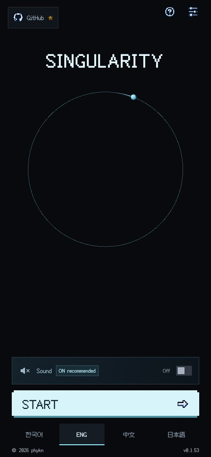
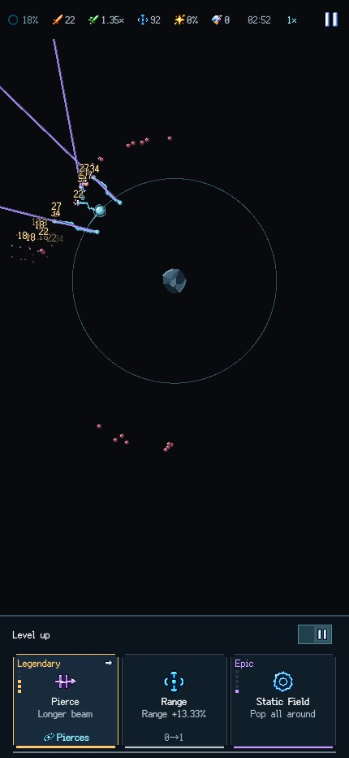
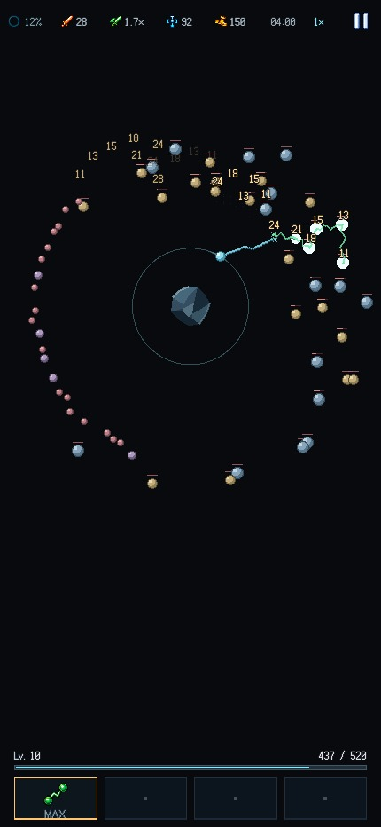

<h1 align="center">SINGULARITY</h1>

<p align="center">A pixel-art survival game where one electron's lightning grows until its orbit gives way.</p>

<p align="center"><b><a href="https://singularity.phykn-kr.workers.dev/">Play now — singularity.phykn-kr.workers.dev</a></b></p>

<p align="center">
  
  <a href="LICENSE"></a>
</p>

<p align="center">
  
  
  
</p>

## Features

- **Automatic combat** — sixteen skills, each with an evolution, and up to three pacts that trade risk for a new way to pop.
- **Rhythm** — tap on the electron's orbit to build a charge and release it.
- **A fixed clock** — five giant particles, a critical breach, then the Higgs particle that decides the run.
- **Endless rounds** — after the singularity, each round brings a giant and is harder than the last.
- **Keycap sound** — every hit clicks, and each skill pops in its own rhythm.
- **Phone and desktop** — Korean, English, Chinese and Japanese; preferences and best results stay on your device.

## Run

Requires Node.js 24 or later. The game opens at [localhost:8081](http://localhost:8081).

```sh
npm ci
npm run dev
```

## Check

Tests for the rules, the session, saved records and text:

```sh
npm test
```

Tests, the rules schema, a 100-run bot measurement and the browser smoke checks, in about two minutes:

```sh
npm run check
```

Every browser scenario (`smoke`, `choices`, `late-game`, `languages`, `performance`, `audio`); name one to run it alone:

```sh
npm run check:browser -- all
```

Type check and production build:

```sh
npm run build
```

## Measure balance

Bots play whole runs: `qte` taps every beat and `qte-off` never taps. The numbers are bot references, not player clear rates.

```sh
npm run sim -- balance 100 480000 artifacts/qte.json qte
npm run sim -- balance 100 480000 artifacts/qte-off.json qte-off
```

One build per skill, and cleared runs continued into endless mode:

```sh
npm run sim -- skills 40 480000
npm run sim -- beyond 50 108000
```

## License

Code is under [PolyForm Noncommercial 1.0.0](LICENSE); commercial use beyond it needs permission from [the developer](https://github.com/phykn). Libraries, fonts and sounds keep their own licenses.

## References

1. TakWolf. _Fusion Pixel Font_. 2022. https://github.com/TakWolf/fusion-pixel-font
2. unicae_games. _Keyboard Soundpack #1: typing and single keystrokes_. OpenGameArt, CC0 1.0. https://opengameart.org/content/keyboard-soundpack-1-typing-and-single-keystrokes
